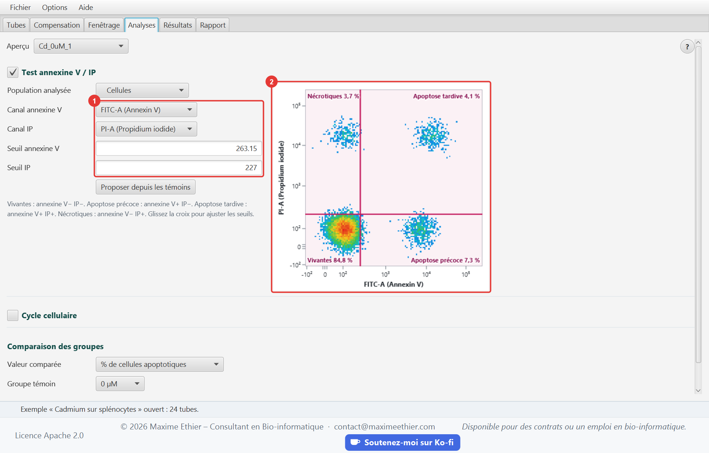

# CytoScope

Outil d'analyse de cytométrie en flux en Java 21 qui permet de :

- lire les fichiers **FCS 2.0, 3.0 et 3.1** (norme de l'ISAC), en entiers ou en nombres réels ;
- **compenser** les fluorescences avec la matrice de débordement écrite par le cytomètre, calculée
  à partir des témoins simple marquage ou modifiée à la main ;
- afficher les événements sur des échelles **linéaire, logarithmique, logicle et arcsinh** ;
- tracer une stratégie de **fenêtrage hiérarchique** commune à tous les tubes : rectangles,
  polygones, quadrants et intervalles, avec export FCS 3.1 de chaque population ;
- mesurer l'**apoptose** (annexine V / iodure de propidium : vivantes, apoptose précoce et tardive,
  nécrose) et le **cycle cellulaire** (sub-G1, G0/G1, S, G2/M, CV du pic G0/G1) ;
- comparer les groupes de traitement par **ANOVA à un facteur et test de Dunnett** contre le
  témoin ;
- ajuster une **courbe dose-réponse logistique à quatre paramètres** et en tirer la CE50 avec son
  intervalle de confiance à 95 % ;
- produire un **rapport PDF** en français ou en anglais, au format Lettre ou A4.

Le même modèle est servi par deux applications indépendantes, toutes deux en architecture MVC :
une application **desktop JavaFX** et une application **web React**, en ligne sur
[cytoscope.maximeethier.com](https://cytoscope.maximeethier.com).



## Données d'exemple

Trois expériences d'exemple sont intégrées aux deux applications :

| Exemple | Tubes | Origine |
|---|---|---|
| U-87MG, annexine V / IP | 18 | **Données réelles** : Hassan et al. (2026), cellules de glioblastome U-87MG, [Mendeley Data](https://doi.org/10.17632/d4r5h95356.1), licence CC BY 4.0, fichiers non modifiés |
| U-87MG, cycle cellulaire | 10 | **Données réelles**, même source |
| Cadmium sur splénocytes | 24 | **Données simulées** par CytoScope (`core/.../tools/SimulatedDoseSeries.java`) : série de doses de 0 à 50 µM en triplicata et témoins, pour illustrer la courbe dose-réponse |

Les données simulées sont signalées comme telles dans l'interface et dans les rapports. L'origine
des données réelles est rappelée dans
[`ATTRIBUTION.md`](core/src/main/resources/com/bioinfo/cytoscope/examples/ATTRIBUTION.md).

## Organisation du dépôt

```
core/       Modèle partagé (Maven, cytoscope-core) : lecture et écriture FCS, compensation,
            échelles, portes et hiérarchie, analyses, statistiques, exemples, rapport PDF et
            façade CytoService
desktop/    Application desktop (Maven, cytoscope-desktop) : vue JavaFX, contrôleurs, aide, i18n
server/     API REST (Maven, cytoscope-server) : espaces de travail en mémoire et contrôleurs HTTP
web/        Application web (npm) : React + TypeScript + Vite
deploy/     Installation sur un serveur Ubuntu (systemd + Caddy)
config/     Règles Checkstyle communes aux modules Java
```

Le modèle n'a aucune dépendance externe hormis PDFBox pour le rapport : lecture FCS, logicle,
ajustement non linéaire (Levenberg-Marquardt) et loi de Dunnett sont écrits dans le projet et
testés sur des valeurs de référence.

### Architecture MVC et patrons de conception

| Couche | Desktop | Web |
|---|---|---|
| Modèle | `core` (`CytoService`) + `DesktopModel` observable | `core` via l'API REST ; `web/src/model` (modèle observable, accès HTTP, types) |
| Vue | FXML : `main-view.fxml`, un fichier par onglet, et le graphique `FlowPlot` | `web/src/views` (composants React sans logique métier) |
| Contrôleur | `MainController` + un contrôleur par onglet | `server/.../controller` (REST) et `web/src/controllers` (hooks) |

- **Façade** : `CytoService` est le seul point d'entrée des applications vers le modèle.
- **Stratégie** : chaque échelle (`Scale`) et chaque forme de porte (`Gate`, hiérarchie scellée)
  est interchangeable ; le graphique et l'analyse ne connaissent que l'interface.
- **Composite** : l'arbre des populations (`GatingTree`, `Population`) applique chaque porte aux
  événements de sa population mère.
- **Monteur (Builder)** : le rapport PDF (`CytoReport.builder`) est assemblé section par section.
- **Fabrique** : `Scales.create` construit l'échelle d'un canal à partir de son type, et
  `Scales.defaultType` choisit ce type (diffusion et ADN linéaires, fluorescences en logicle).
- **Dépôt** : les tubes sont lus par l'intermédiaire de l'interface `SampleStore`
  (`InMemorySampleStore` pour le desktop, l'espace de travail pour le serveur).
- **Objets immuables** : l'expérience (`Experiment`) et ses réglages sont des `record` ; chaque
  modification renvoie une nouvelle valeur, ce qui rend l'annulation et le partage entre threads
  sans risque.

## Application desktop

- Six onglets : **Tubes**, **Compensation**, **Fenêtrage**, **Analyses**, **Résultats**,
  **Rapport** (Ctrl+1 à Ctrl+6).
- Fichiers FCS ouverts par le menu (Ctrl+O) ou **glissés sur la fenêtre** ; les portes se tracent
  et se déplacent à la souris, Échap annule le tracé en cours.
- Interface **bilingue français/anglais** (menu *Options › Langue*) et **taille du texte**
  réglable (Ctrl + / Ctrl − / Ctrl 0), mémorisées.
- Menu **Aide** : guide d'utilisateur illustré (F1) avec recherche, bouton **?** dans chaque
  onglet, raccourcis clavier, norme FCS, source des données d'exemple, **À propos**.

Le guide est rédigé en Markdown :
[`guide_fr.md`](desktop/src/main/resources/com/bioinfo/cytoscope/desktop/help/guide_fr.md),
[`guide_en.md`](desktop/src/main/resources/com/bioinfo/cytoscope/desktop/help/guide_en.md).
Ses captures d'écran et les icônes sont générées automatiquement :

```powershell
.\mvnw -pl desktop javafx:run@screenshots   # captures FR + EN du guide
.\mvnw -pl desktop javafx:run@icons         # icônes PNG, packaging/CytoScope.ico, favicon web
```

### Distribution Windows

```powershell
cd desktop
.\package-windows.ps1            # ajouter -SkipTests pour aller plus vite
```

Le script produit `desktop/target/dist/CytoScope-<version>-windows-x64.zip`. Ce zip est autonome :
il contient `CytoScope.exe`, un runtime Java 21 allégé par jlink et un dossier `examples` de
fichiers FCS réels à ouvrir. Aucune installation de Java n'est requise.

## Application web

L'application web offre les mêmes fonctions que l'application desktop, onglet par onglet : mêmes
calculs, mêmes messages FR/EN, même guide illustré. Les différences tiennent au navigateur :

- **Alt+1 à Alt+6** changent d'onglet (Ctrl+1 à 6 sont réservés aux onglets du navigateur) ;
- les fichiers FCS sont **envoyés au serveur**, qui les garde **en mémoire seulement**, jamais
  sur disque, et les oublie 30 minutes après la dernière action (50 Mo au plus par fichier) ;
- le rapport PDF et les populations exportées sont **téléchargés** ;
- le guide s'ouvre dans un panneau à droite plutôt que dans une fenêtre.

Le guide web : [`guide_fr.md`](web/src/help/guide_fr.md), [`guide_en.md`](web/src/help/guide_en.md).
Ses captures sont générées en pilotant l'application dans Microsoft Edge :

```powershell
cd web; npm run screenshots              # API et "npm run dev" lancés
```

## Démarrage rapide

Prérequis : JDK 21, Git et Node.js 20 ou plus récent (Maven est fourni par `mvnw`).

```powershell
.\mvnw install -DskipTests               # compile les modules Java
.\mvnw -pl desktop javafx:run            # application desktop

.\mvnw -pl server exec:java              # API REST sur http://127.0.0.1:7072/api
cd web; npm ci; npm run dev              # application web sur http://localhost:5175
```

En développement, Vite redirige les appels `/api` vers le serveur REST.

## Qualité du code

- **Lisibilité** : aucune ligne ne dépasse 100 colonnes. Le code Java est formaté avec
  google-java-format (style AOSP, indentation de 4 espaces), le code TypeScript avec Prettier.
- **Commentaires** : chaque classe et chaque méthode publique est documentée en Javadoc ou TSDoc.
- **Vérifications automatiques** :
  - Checkstyle (`config/checkstyle`) s'exécute dès la phase `validate` de Maven et fait échouer le
    build en cas de violation ;
  - ESLint (TypeScript, règles des hooks React) et Prettier côté web ;
  - l'intégration continue GitHub (`.github/workflows/ci.yml`) compile et teste tout à chaque
    envoi, y compris les tests fonctionnels du site web.

## Tests et couverture

```powershell
.\mvnw verify                    # Checkstyle, tests JUnit 5 et couverture JaCoCo
cd web; npm run check            # types, ESLint, Prettier, tests Vitest et couverture
npm run test:e2e:local           # tests fonctionnels Playwright (API et "npm run dev" lancés)
```

| Module | Tests | Contenu |
|---|---|---|
| `core` | 105 | Lecture et écriture FCS, compensation, échelles, portes, analyses, ANOVA, Dunnett, ajustement 4PL, exemples, rapport PDF |
| `desktop` | 85 | Contrôleurs pilotés comme par un utilisateur sur JavaFX sans écran (Monocle), gestes de la souris sur les graphiques, messages FR/EN, guide d'aide, préférences |
| `server` | 14 | Tests d'intégration de l'API REST, des espaces de travail et des codes d'erreur |
| `web` (Vitest) | 101 | Modèle, accès à l'API, contrôleurs et vues, graphiques, guide, messages FR/EN |
| `web` (Playwright) | 7 × 2 | Parcours d'un visiteur en français et en anglais sur les trois exemples, envoi de fichiers, fenêtrage, rapport PDF, guide |

JaCoCo fait échouer le build si la couverture d'un module Java passe sous **95 % des lignes** et
**90 % des branches** ; Vitest applique les mêmes seuils au client web. Une vérification
quotidienne (`.github/workflows/monitor.yml`) rejoue les tests fonctionnels sur le site en ligne.

## API REST

Chaque visiteur travaille dans un **espace de travail** en mémoire, identifié par un jeton
aléatoire et fermé après 30 minutes d'inactivité.

| Méthode | Route | Description |
|---|---|---|
| GET | `/api/health` | État du serveur |
| GET | `/api/examples` | Exemples disponibles et attribution des données réelles |
| POST | `/api/workspaces` | `{example, language}` : ouvre un espace vide ou un exemple |
| GET / DELETE | `/api/workspaces/{id}` | Lit ou ferme l'espace |
| POST | `/api/workspaces/{id}/samples?name=` | Corps : fichier FCS brut |
| DELETE | `/api/workspaces/{id}/samples/{tube}` | Retire un tube |
| GET | `/api/workspaces/{id}/samples/{tube}/fcs?population=` | Exporte une population en FCS 3.1 |
| PUT | `/api/workspaces/{id}/experiment` | Remplace le réglage (rôles, compensation, portes, analyses) |
| POST | `/api/workspaces/{id}/compensation/controls` | Matrice calculée à partir des simples marquages |
| POST | `/api/workspaces/{id}/compensation/file` | Matrice écrite dans les fichiers |
| POST | `/api/workspaces/{id}/apoptosis/suggest` | Seuils annexine V / IP proposés à partir des témoins |
| POST | `/api/workspaces/{id}/plot` | Densité ou histogramme d'une population |
| GET | `/api/workspaces/{id}/results` | Résultats par tube, comparaison des groupes, courbe dose-réponse |
| POST | `/api/workspaces/{id}/report` | Rapport PDF, envoyé en pièce jointe |

Codes d'erreur : **400** (entrée invalide ou fichier FCS illisible), **404** (route, espace ou
tube inconnu), **405** (méthode non permise), **410** (espace expiré), **413** (fichier de plus de 50 Mo). Le corps contient
`error` et la catégorie `kind`, traduite par le client.

## Déploiement

Le site tourne sur un serveur Ubuntu 24.04 partagé avec les autres applications du portfolio.
Après avoir construit le client (`cd web; npm run build`), copier `web/dist` et
`deploy/setup-server.sh` sur le serveur, puis lancer en root :

```bash
bash setup-server.sh cytoscope.maximeethier.com
```

Le script installe l'API comme service systemd sur le port 7072 et ajoute le site à Caddy
(`/etc/caddy/sites/<domaine>.caddy`), qui obtient le certificat HTTPS. Le relancer met le site à
jour depuis GitHub.

## Licence

Copyright 2026 Maxime Ethier - Consultant en Bioinformatique/Biocomputing Consultant.

Ce projet est distribué sous la licence Apache 2.0 : voir le fichier [`LICENSE`](LICENSE).
L'application web publie ce fichier sous le nom `LICENSE.txt` et y renvoie depuis son pied de
page. Les données U-87MG restent sous leur licence d'origine, CC BY 4.0.
