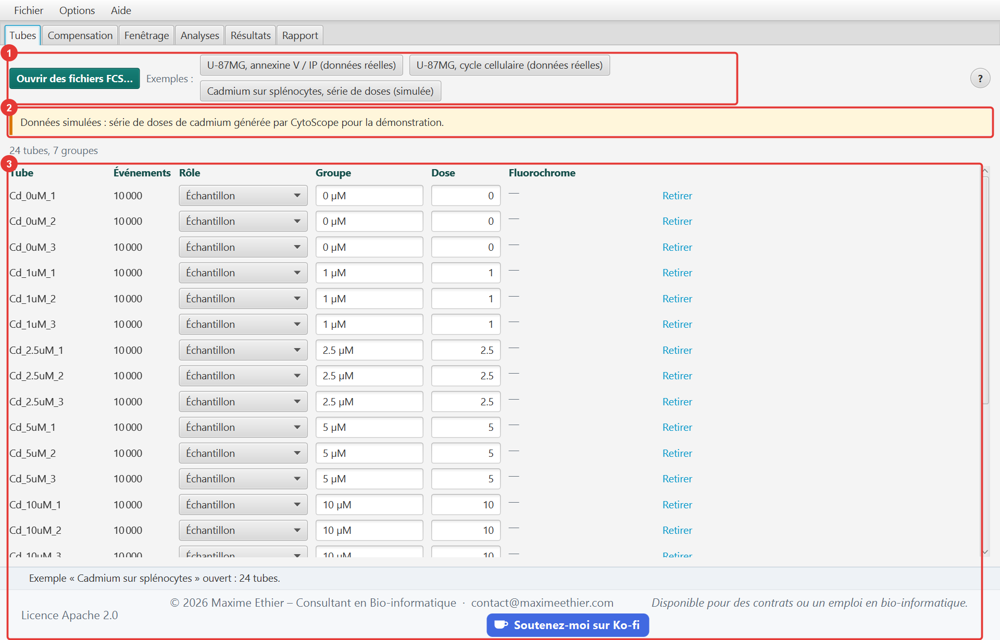
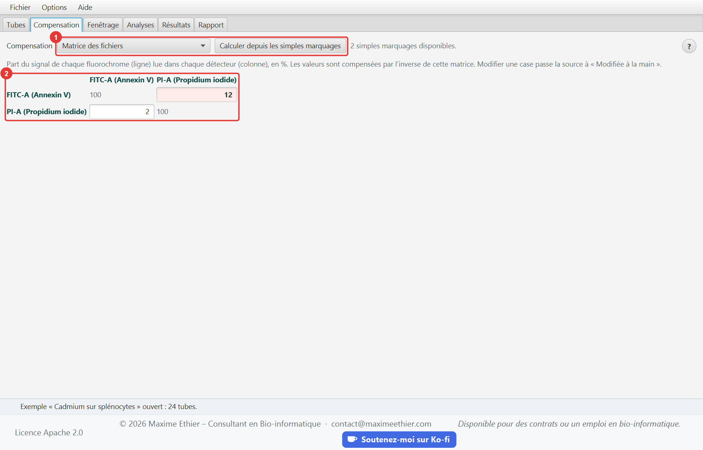
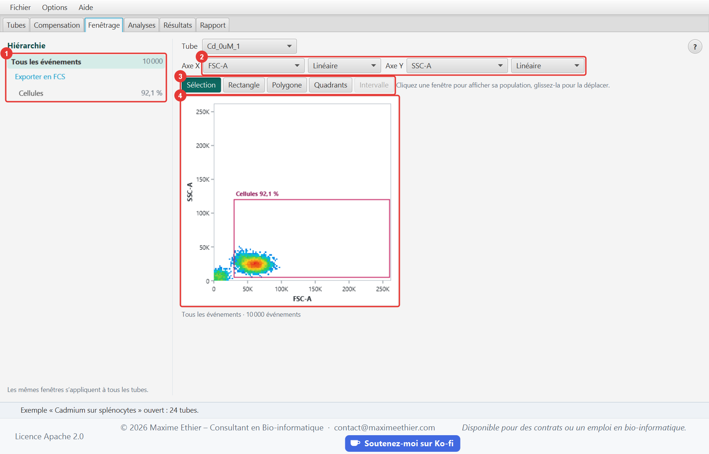
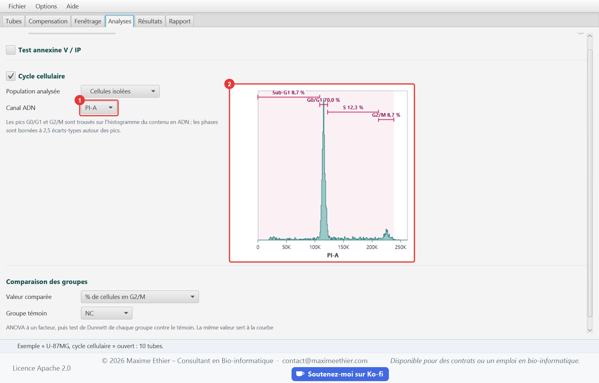
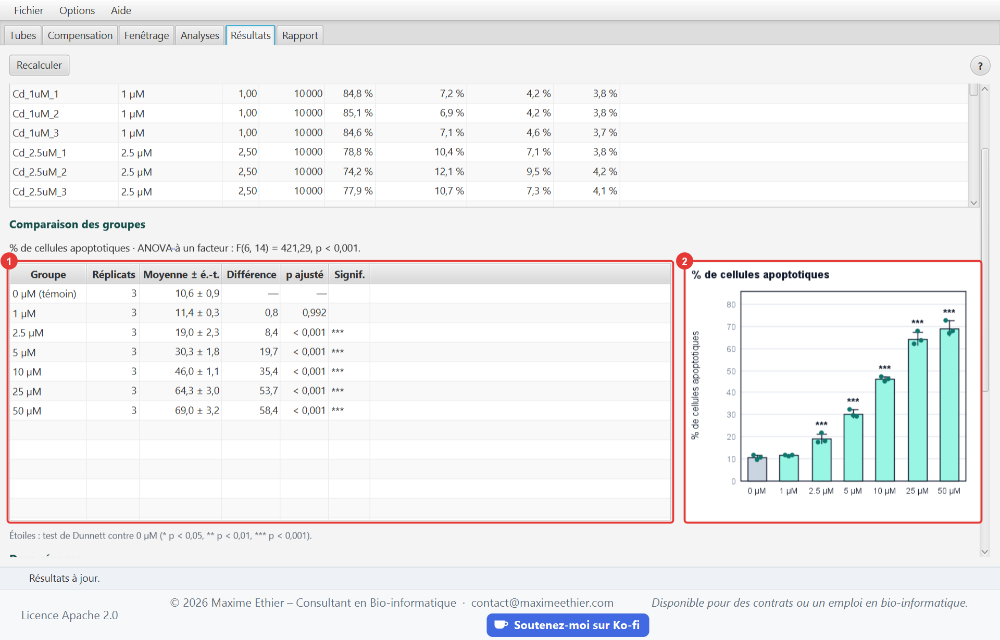
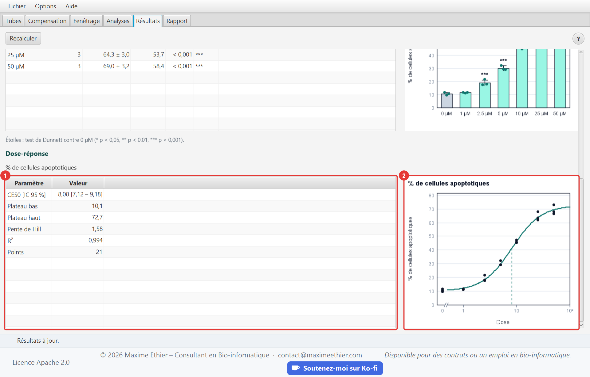
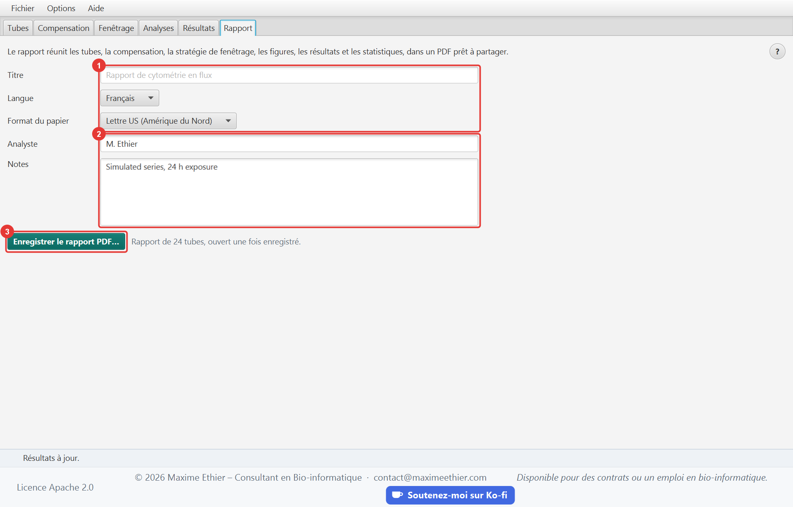

**Guide d’utilisation de CytoScope**

<!-- section: start -->
# Démarrage rapide

CytoScope analyse des expériences de cytométrie en flux : il lit les fichiers FCS, compense les fluorescences, applique une stratégie de fenêtrage commune à tous les tubes, mesure l’apoptose (annexine V / IP) et le cycle cellulaire, compare les groupes de traitement et ajuste une courbe dose-réponse. Tout se termine par un rapport PDF.

1. Ouvrez vos fichiers FCS (Ctrl+O, ou glissez-les sur l’onglet **Tubes**), ou une expérience d’exemple.
2. Vérifiez le rôle, le groupe et la dose de chaque tube dans l’onglet **Tubes**.
3. Réglez la matrice de débordement dans l’onglet **Compensation**.
4. Tracez les fenêtres dans l’onglet **Fenêtrage**.
5. Choisissez les analyses et la valeur comparée dans l’onglet **Analyses**.
6. Lisez les statistiques dans l’onglet **Résultats**, puis enregistrez le rapport dans l’onglet **Rapport**.

> Trois expériences d’exemple sont proposées : deux jeux de données réels de cellules de glioblastome U-87MG (Hassan et al., 2026, [Mendeley Data](https://doi.org/10.17632/d4r5h95356.1), CC BY 4.0), l’un pour l’apoptose, l’autre pour le cycle cellulaire, et une série de doses de cadmium sur des splénocytes de souris, simulée par CytoScope pour illustrer la courbe dose-réponse.

Le bouton **?** de chaque onglet, ou la touche F1, ouvre ce guide à la section de l’onglet courant. La barre d’état, en bas de la fenêtre, résume chaque opération et explique les erreurs. Ctrl+1 à Ctrl+6 affichent les onglets ; le menu **Options** change la langue et la taille du texte.

Tout est calculé sur votre ordinateur : les fichiers sont seulement lus, jamais modifiés ni envoyés ailleurs. Le menu **Fichier > Nouvelle expérience** oublie les tubes chargés.

<!-- section: tubes -->
# Onglet Tubes

## Charger les fichiers

CytoScope lit les fichiers FCS 2.0, 3.0 et 3.1 (norme de l’ISAC), en entiers ou en nombres réels. Ouvrez-en plusieurs à la fois avec **Ouvrir des fichiers FCS…**, ou déposez-les sur l’onglet. Les fichiers chargés ensuite s’ajoutent aux premiers.

## Rôle, groupe et dose

CytoScope devine le rôle, le groupe et la dose de chaque tube d’après le nom du fichier et ses mots-clés ; corrigez-les au besoin :

| Rôle | Utilisation |
|---|---|
| Échantillon | tube analysé et comparé aux autres |
| Témoin non marqué | référence négative pour la compensation et les seuils |
| Simple marquage | un seul fluorochrome, pour calculer la matrice de débordement ; indiquez son canal |

Les réplicats d’une même condition portent le même **groupe** (par exemple « TMZ »). La **dose** sert à la courbe dose-réponse ; laissez-la vide si elle est sans objet. Le bouton **Retirer** enlève un tube de l’expérience.

<!-- section: compensation -->
# Onglet Compensation

Un fluorochrome émet aussi dans les détecteurs voisins : c’est le débordement. La compensation le retire en multipliant les valeurs de chaque événement par l’inverse de la **matrice de débordement**, dont chaque ligne donne la part du signal d’un fluorochrome lue dans chaque détecteur.

| Source | Matrice |
|---|---|
| Aucune | valeurs brutes |
| Matrice des fichiers | mot-clé $SPILLOVER (ou SPILL) écrit par le cytomètre |
| Calculée à partir des simples marquages | sur les événements de chaque simple marquage plus brillants que 99,5 % du témoin non marqué, médiane du rapport entre la hausse du signal dans chaque détecteur et la hausse dans le canal du fluorochrome |
| Modifiée à la main | toute matrice dont vous avez changé une case |

Les cases sont en pourcentage ; celles qui dépassent 5 % sont mises en évidence. Une compensation juste donne des populations positives et négatives alignées, sans diagonale, sur les graphiques de deux fluorescences.

<!-- section: gating -->
# Onglet Fenêtrage

## Hiérarchie

La colonne de gauche montre l’arbre des populations, avec la part du parent de chacune dans le tube affiché. Cliquez une population pour l’afficher : le graphique montre ses événements, et les fenêtres de ses populations filles. Les mêmes fenêtres s’appliquent à tous les tubes. Une population sélectionnée peut être renommée, supprimée (avec ses descendantes) ou exportée en FCS 3.1 pour le tube affiché.

## Axes et échelles

Choisissez le canal de chaque axe ; un axe Y vide donne un histogramme. Quatre échelles sont proposées :

| Échelle | Utilisation |
|---|---|
| Linéaire | diffusion (FSC, SSC) et contenu en ADN |
| Logarithmique | fluorescences sans valeur négative |
| Logicle | fluorescences compensées : linéaire autour de zéro, logarithmique au-delà (Parks et al., 2006) |
| Arcsinh | variante de logicle, courante en cytométrie de masse |

Par défaut, la diffusion et le canal ADN sont linéaires, les autres fluorescences en logicle.

## Tracer et ajuster les fenêtres

| Outil | Geste |
|---|---|
| Sélection | cliquer une fenêtre affiche sa population ; la glisser la déplace |
| Rectangle | glisser en diagonale |
| Polygone | cliquer chaque sommet, puis double-cliquer ou cliquer le premier sommet |
| Quadrants | cliquer le point de croisement : quatre populations sont créées |
| Intervalle | glisser sur un histogramme |

Échap annule le tracé en cours. Une fenêtre déplacée garde sa forme sur l’échelle affichée ; les quatre régions d’une croix de quadrants se déplacent ensemble.

<!-- section: analyses -->
# Onglet Analyses

## Test annexine V / IP

L’annexine V marque la phosphatidylsérine exposée dès le début de l’apoptose ; l’iodure de propidium (IP) n’entre que dans les cellules dont la membrane est rompue. Deux seuils partagent la population analysée en quatre états :

| Annexine V | IP | État |
|---|---|---|
| − | − | vivantes |
| + | − | apoptose précoce |
| + | + | apoptose tardive |
| − | + | nécrotiques |

Glissez la croix sur l’aperçu, saisissez les seuils, ou cliquez **Proposer depuis les témoins** : chaque seuil est placé au 99e centile des témoins sans ce marquage (non marqué et simple marquage de l’autre fluorochrome).

## Cycle cellulaire

Sur l’histogramme du contenu en ADN, CytoScope trouve le pic G0/G1 et le pic G2/M (vers le double), puis borne les phases à 2,5 écarts-types autour des pics : sub-G1 (ADN fragmenté, cellules apoptotiques) sous G0/G1, S entre les deux pics. Le CV du pic G0/G1 mesure la qualité de la coloration ; au-delà d’environ 8 %, les phases sont moins fiables.

## Comparaison des groupes

Choisissez la **valeur comparée** (part de cellules apoptotiques, d’un état, d’une phase ou d’une population) et le **groupe témoin**. CytoScope fait une ANOVA à un facteur, puis le test de Dunnett de chaque groupe contre le témoin. La même valeur sert à la courbe dose-réponse.

<!-- section: results -->
# Onglet Résultats

Les résultats sont recalculés à l’ouverture de l’onglet chaque fois que le réglage a changé.

- Le **tableau par tube** donne le nombre d’événements, les quatre états du test annexine V / IP et les phases du cycle cellulaire.
- La **comparaison des groupes** donne la moyenne, l’écart-type et les réplicats de chaque groupe, la différence avec le témoin et la probabilité ajustée du test de Dunnett. Étoiles : * p < 0,05, ** p < 0,01, *** p < 0,001.
- La **courbe dose-réponse** est un modèle logistique à quatre paramètres (plateaux bas et haut, CE50, pente de Hill) ajusté sur tous les réplicats ; la CE50 est donnée avec son intervalle de confiance à 95 %. Il faut au moins cinq tubes et deux doses non nulles.

Si une analyse ne peut pas être faite, la raison est affichée à sa place.

<!-- section: report -->
# Onglet Rapport

Le rapport PDF réunit les tubes, la compensation, la stratégie de fenêtrage, les figures de chaque analyse, les résultats et les statistiques, avec la source des données d’exemple. Donnez-lui un titre, le nom de l’analyste et des notes facultatives, et choisissez sa langue, indépendante de celle de l’interface, ainsi que le format du papier. Ctrl+S l’enregistre depuis n’importe quel onglet ; il s’ouvre dans votre lecteur PDF une fois enregistré.

