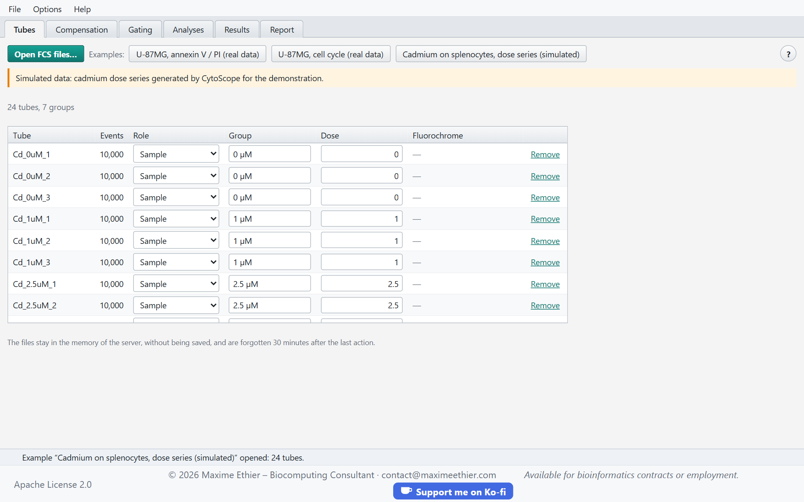
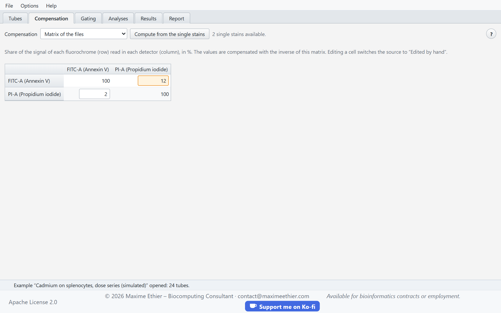
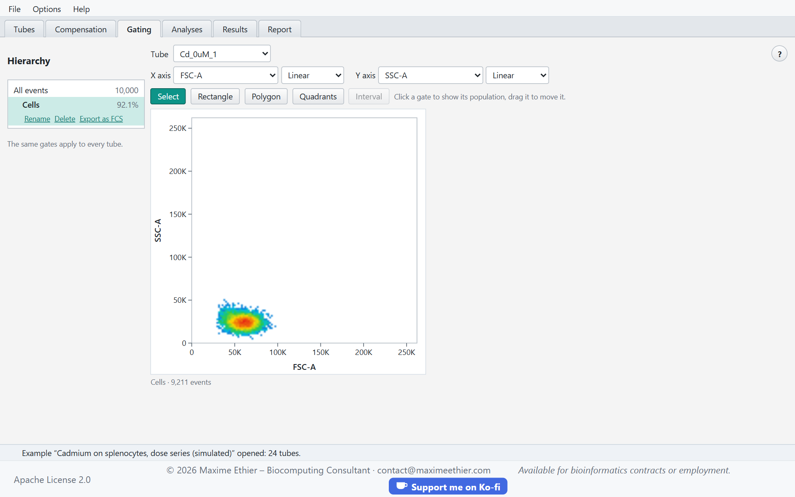
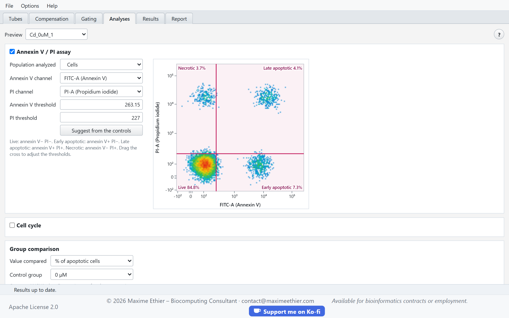
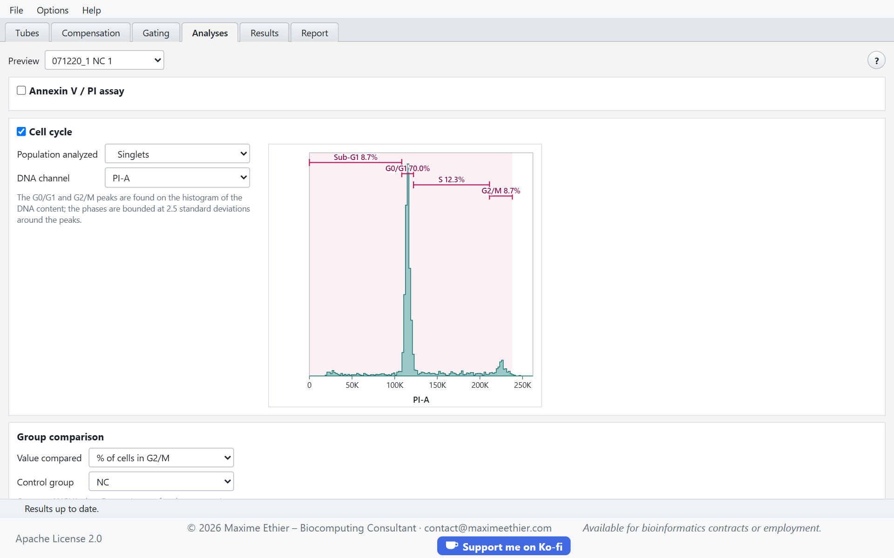
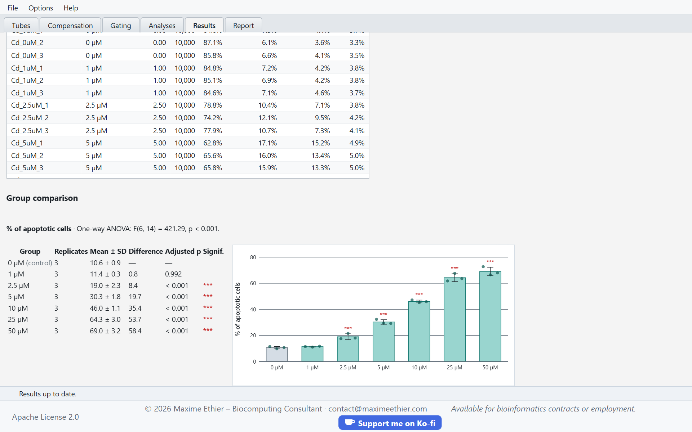
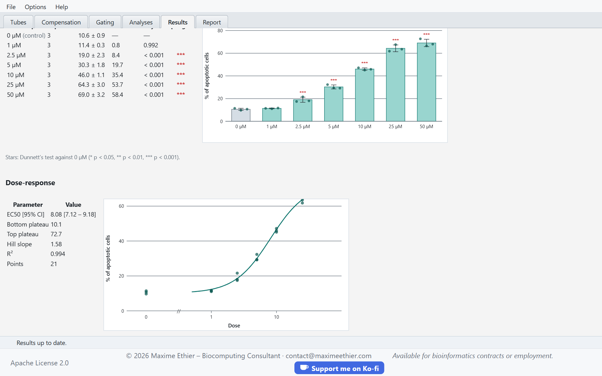
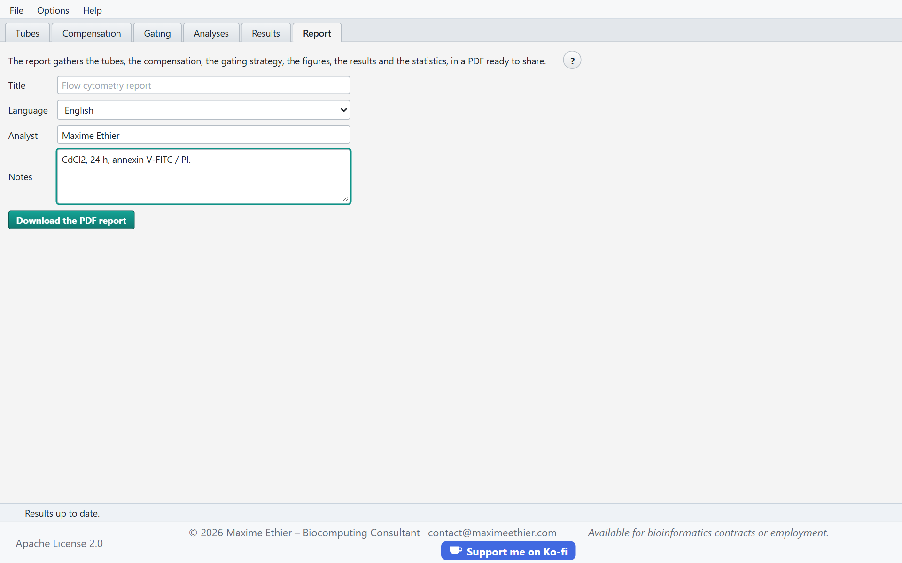

**CytoScope user guide**

<!-- section: start -->
# Quick start

CytoScope analyzes flow cytometry experiments: it reads FCS files, compensates the fluorescences, applies one gating strategy to every tube, measures apoptosis (annexin V / PI) and the cell cycle, compares the treatment groups and fits a dose-response curve. Everything ends with a PDF report.

1. Open your FCS files (Ctrl+O, or drop them on the **Tubes** tab), or an example experiment.
2. Check the role, group and dose of each tube in the **Tubes** tab.
3. Set the spillover matrix in the **Compensation** tab.
4. Draw the gates in the **Gating** tab.
5. Choose the analyses and the value compared in the **Analyses** tab.
6. Read the statistics in the **Results** tab, then download the report in the **Report** tab.

> Three example experiments are offered: two real data sets of U-87MG glioblastoma cells (Hassan et al., 2026, Mendeley Data, CC BY 4.0), one for apoptosis and one for the cell cycle, and a cadmium dose series on mouse splenocytes, simulated by CytoScope to illustrate the dose-response curve.

The **?** button of each tab, or the F1 key, opens this guide at the section of the current tab. The status bar, at the bottom of the page, sums up each operation and explains the errors.

Your files stay in the memory of the server, without being saved to disk, and are forgotten 30 minutes after your last action. The **File > New experiment** menu forgets them at once. The desktop application offers the same features without a connection.

<!-- section: tubes -->
# Tubes tab

## Loading the files

CytoScope reads FCS 2.0, 3.0 and 3.1 files (ISAC standard), with integer or floating-point data, up to 50 MB per file. Open several at once with **Open FCS files…**, or drop them on the tab. Files loaded later are added to the first ones.

## Role, group and dose

CytoScope guesses the role, group and dose of each tube from the file name and its keywords; correct them if needed:

| Role | Use |
|---|---|
| Sample | tube analyzed and compared with the others |
| Unstained control | negative reference for the compensation and the thresholds |
| Single stain | one fluorochrome only, to compute the spillover matrix; give its channel |

The replicates of one condition share the same **group** (for instance “TMZ”). The **dose** is used for the dose-response curve; leave it empty if not relevant. The **Remove** button takes a tube out of the experiment.

<!-- section: compensation -->
# Compensation tab

A fluorochrome also emits in the neighbouring detectors: this is spillover. Compensation removes it by multiplying the values of each event by the inverse of the **spillover matrix**, each row of which gives the share of the signal of one fluorochrome read in each detector.

| Source | Matrix |
|---|---|
| None | raw values |
| Matrix of the files | $SPILLOVER (or SPILL) keyword written by the cytometer |
| Computed from the single stains | on the events of each single stain brighter than 99.5% of the unstained control, median ratio of the rise of the signal in each detector to the rise in the channel of the fluorochrome |
| Edited by hand | any matrix in which you changed a cell |

The cells are in percent; those above 5% are highlighted. A good compensation gives aligned positive and negative populations, without a diagonal, on the plots of two fluorescences.

<!-- section: gating -->
# Gating tab

## Hierarchy

The left column shows the tree of the populations, with the share of the parent of each one in the tube shown. Click a population to show it: the plot shows its events and the gates of its child populations. The same gates apply to every tube. A selected population can be renamed, deleted (with its descendants) or exported as FCS 3.1 for the tube shown.

## Axes and scales

Choose the channel of each axis; an empty Y axis gives a histogram. Four scales are offered:

| Scale | Use |
|---|---|
| Linear | scatter (FSC, SSC) and DNA content |
| Logarithmic | fluorescences without negative values |
| Logicle | compensated fluorescences: linear around zero, logarithmic beyond (Parks et al., 2006) |
| Arcsinh | variant of logicle, common in mass cytometry |

By default, scatter and the DNA channel are linear, the other fluorescences logicle.

## Drawing and adjusting gates

| Tool | Gesture |
|---|---|
| Select | clicking a gate shows its population; dragging it moves it |
| Rectangle | drag diagonally |
| Polygon | click each vertex, then double-click or click the first vertex |
| Quadrants | click the crossing point: four populations are created |
| Interval | drag on a histogram |

Escape cancels the drawing in progress. A moved gate keeps its shape on the scale shown; the four regions of a quadrant cross move together.

<!-- section: analyses -->
# Analyses tab

## Annexin V / PI assay

Annexin V binds the phosphatidylserine exposed early in apoptosis; propidium iodide (PI) only enters cells whose membrane is broken. Two thresholds split the population analyzed into four states:

| Annexin V | PI | State |
|---|---|---|
| − | − | live |
| + | − | early apoptotic |
| + | + | late apoptotic |
| − | + | necrotic |

Drag the cross on the preview, type the thresholds, or click **Suggest from the controls**: each threshold is put at the 99th percentile of the controls without that stain (unstained and single stain of the other fluorochrome).

## Cell cycle

On the histogram of the DNA content, CytoScope finds the G0/G1 peak and the G2/M peak (near twice as far), then bounds the phases at 2.5 standard deviations around the peaks: sub-G1 (fragmented DNA, apoptotic cells) below G0/G1, S between the two peaks. The CV of the G0/G1 peak measures the quality of the staining; above about 8%, the phases are less reliable.

## Group comparison

Choose the **value compared** (share of apoptotic cells, of a state, of a phase or of a population) and the **control group**. CytoScope runs a one-way ANOVA, then Dunnett’s test of each group against the control. The same value is used for the dose-response curve.

<!-- section: results -->
# Results tab

The results are computed again when the tab is opened, whenever the set-up has changed.

- The **table per tube** gives the number of events, the four states of the annexin V / PI assay and the phases of the cell cycle.
- The **group comparison** gives the mean, standard deviation and replicates of each group, the difference with the control and the adjusted probability of Dunnett’s test. Stars: * p < 0.05, ** p < 0.01, *** p < 0.001.
- The **dose-response curve** is a four-parameter logistic model (bottom and top plateaus, EC50, Hill slope) fitted on all the replicates; the EC50 is given with its 95% confidence interval. At least five tubes and two non-zero doses are needed.

If an analysis cannot be done, the reason is shown in its place.

<!-- section: report -->
# Report tab

The PDF report gathers the tubes, the compensation, the gating strategy, the figures of each analysis, the results and the statistics, with the source of the example data. Give it a title, the name of the analyst and optional notes, and choose its language, independent of that of the interface. Ctrl+S downloads it from any tab.

